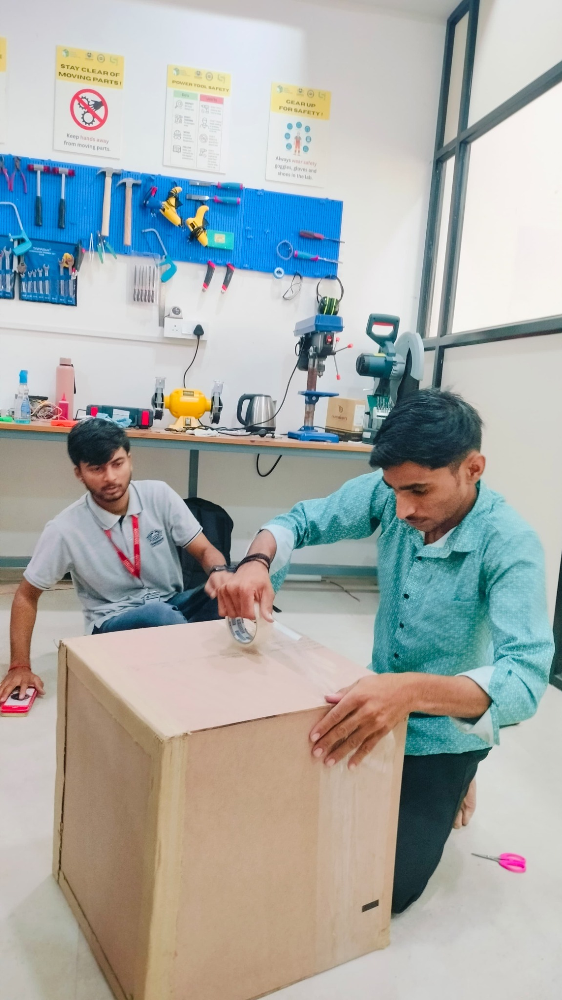
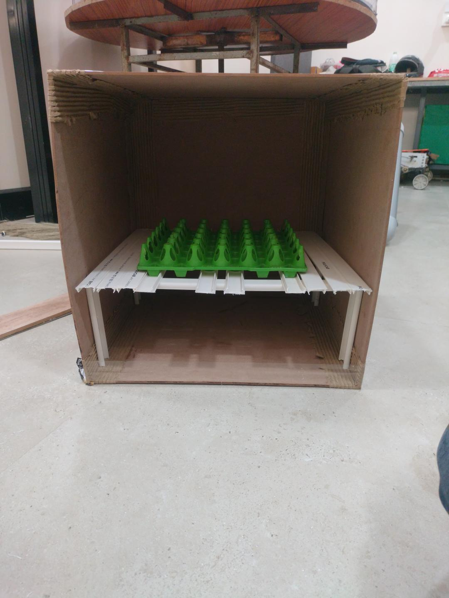

# Smart Automatic Egg Incubator

An Arduino-based incubator prototype designed to monitor and regulate the internal temperature for egg incubation.

> **Project documentation status:** This repository is being prepared from the actual prototype information and the two original photographs supplied by the project team. Sections marked **To be added / verified** must be completed using actual build details, measurements, photographs, and test observations. No unverified performance results are claimed.

## 1. Project Overview

The Smart Automatic Egg Incubator is a prototype intended to provide a controlled environment for egg incubation. The design uses a temperature sensor, a microcontroller, a relay-controlled heating arrangement, an air-circulation fan, an LCD interface, and an audible alert.

The documented enclosure is approximately **45 cm × 45 cm**. The internal arrangement includes an egg tray supported above the lower compartment. A 12 V DC fan is mounted on a side panel. The project team has also described the use of an Arduino Nano, DHT22 temperature sensor, I2C LCD, relay module, buzzer, and a PTC heating element.

**Important:** The final heater rating, wiring, power supply arrangement, control thresholds, and completed operating status must be checked against the final physical prototype before publication.

## 2. Problem Statement

Egg incubation requires a suitably controlled environment. Manual monitoring and adjustment can require frequent attention and may lead to temperature variation if not managed consistently.

This project explores a low-cost, microcontroller-based approach to monitoring temperature and controlling a heating system, with air circulation inside the incubator enclosure.

## 3. Objectives

- Develop a compact incubator enclosure for a prototype.
- Monitor internal temperature using a digital temperature sensor.
- Display operating information on an I2C LCD.
- Control the heating arrangement through a relay and programmed temperature limits.
- Circulate air inside the enclosure using a DC fan.
- Provide an audible alert using a buzzer where required.
- Build and document a physical prototype and evaluate its operation through testing.

## 4. Design and System Architecture

### Enclosure and internal layout

- Approximate enclosure size: **45 cm × 45 cm** (confirm the third dimension and internal dimensions before final release).
- An egg tray is positioned on an internal support structure.
- The lower compartment remains available below the egg-tray level.
- A DC fan is mounted on a side panel.
- Electronic components are intended to be mounted on the upper panel, as described by the project team.

### Main components

| Component | Documented role | Status / note |
|---|---|---|
| Arduino Nano | Main controller | Reported as used |
| DHT22 | Temperature sensing | Reported as used; verify final installed sensor |
| I2C LCD | Display | Reported as used |
| Relay module | Switching the heater circuit | Verify module rating and final wiring |
| 12 V DC fan | Air circulation | Side-panel mounting reported |
| Buzzer | Audible alert | Reported as used |
| PTC heating element | Heat generation | Final rating and installation to be verified |
| DC power supply / converter | Power distribution | Final voltage, current, and protection to be documented |

## 5. Working Principle

1. The temperature sensor measures the air temperature inside the enclosure.
2. The Arduino reads the sensor data.
3. The measured temperature is shown on the LCD.
4. The controller compares the measured temperature with the programmed control limits.
5. The relay switches the heating circuit according to the verified control logic.
6. The fan circulates air to help distribute heat within the enclosure.
7. The buzzer can provide an alert if the programmed alert condition is met.

The exact setpoints, relay active state, sensor update interval, and alarm conditions must match the final uploaded Arduino code.

## 6. Fabrication and Assembly

### 6.1 Enclosure fabrication

The enclosure was assembled as a box-shaped structure. The supplied workshop photograph documents a fabrication/assembly stage.

*Figure 1. Workshop fabrication and assembly of the incubator enclosure.*

### 6.2 Internal structure and egg-tray installation

The supplied photograph shows the internal compartment, support structure, and green egg tray positioned inside the enclosure.

*Figure 2. Internal support arrangement and egg-tray placement.*

### 6.3 Electronics integration

**To be added / verified:** Add original photographs of the Arduino, sensor, LCD, relay, buzzer, fan, heater, wiring, and power connections. Include a circuit diagram and explain electrical safety measures.

### 6.4 Final assembly

**To be added / verified:** Add photographs of the fully assembled prototype from the front, side, inside, and top.

## 7. Arduino Software

The project uses Arduino-based control. The final source code should be uploaded to `src/` and should include:

- Required libraries and board details.
- Sensor pin and type.
- LCD configuration.
- Relay and buzzer pin assignments.
- Temperature ON/OFF thresholds.
- Sensor error handling and alarm logic.
- Comments explaining the control sequence.

**To be added:** Upload the exact final code used in the physical prototype. Do not use an earlier test sketch as the final code unless it matches the assembled circuit.

## 8. Testing and Results

Testing must be recorded using actual observations. Suggested tests:

| Test | What to record | Result |
|---|---|---|
| Sensor reading | Reference thermometer value and DHT22 reading | To be measured |
| LCD operation | Whether readings display correctly | To be verified |
| Relay operation | ON/OFF response at the programmed thresholds | To be verified |
| Heater performance | Temperature rise over time and power rating | To be measured |
| Air circulation | Temperature at multiple locations in the enclosure | To be measured |
| Stability test | Temperature variation over a defined duration | To be measured |
| Alarm test | Buzzer response to the programmed condition | To be verified |

Do not claim successful incubation or hatching unless eggs were actually incubated and the outcome was recorded. A temperature-control demonstration is not the same as a successful hatching test.

## 9. Project Video

Place the final one-minute demonstration video in `assets/videos/`.

Suggested sequence:
- 0–10 s: Introduce the project and its purpose.
- 10–20 s: Show the enclosure and internal egg-tray arrangement.
- 20–35 s: Show the electronics and sensor/LCD.
- 35–50 s: Demonstrate actual temperature reading and control response.
- 50–60 s: Show the complete prototype and summarize verified results.

**To be added:** Upload the actual recorded video and embed or link it here.

## 10. Project Poster

Place the final poster in `poster/` and add its preview or link here.

The poster should include the problem, proposed solution, system architecture, key components, actual prototype photographs, and verified test outcomes.

**To be added:** Final poster file.

## 11. LaTeX Project Report

The LaTeX source and compiled PDF will be stored in `report_latex/`.

**To be added:** Final `.tex` source, bibliography if used, supporting figures, and compiled PDF.

## 12. Project Evidence

Original evidence should be organized in the `evidence/` folders:

- `design_process/` — sketches, dimensions, and design decisions.
- `fabrication/` — cutting, joining, drilling, and enclosure work.
- `electronics_integration/` — circuit, wiring, and component installation.
- `assembly/` — internal structure and component assembly.
- `testing/` — original test photographs, videos, and measurement logs.
- `final_product/` — final prototype photographs and demonstration.

Only genuine project evidence should be uploaded. Keep original files and do not alter images in a way that misrepresents the prototype.

## 13. Current Documentation Status

| Deliverable | Current status |
|---|---|
| GitHub README draft | Prepared |
| Original project photos | 2 unique photos included |
| Arduino final source | To be added / verified |
| Circuit diagram | To be added |
| One-minute video | To be recorded / added |
| Project poster | To be prepared |
| LaTeX source and compiled PDF | To be completed |
| Testing measurements and results | To be recorded |

## 14. Safety Notes

A heating element can cause burns, overheating, fire, or electrical hazards. Use appropriately rated wiring, connectors, relay/driver hardware, fuse protection, and a suitable power supply. Keep combustible materials away from the heater, provide secure mounting and ventilation, and supervise testing. Verify the heater and fan ratings and the circuit design before energizing the prototype.

---

**Project:** Smart Automatic Egg Incubator  
**Repository purpose:** Complete project documentation, source code, media, report, and evidence.
